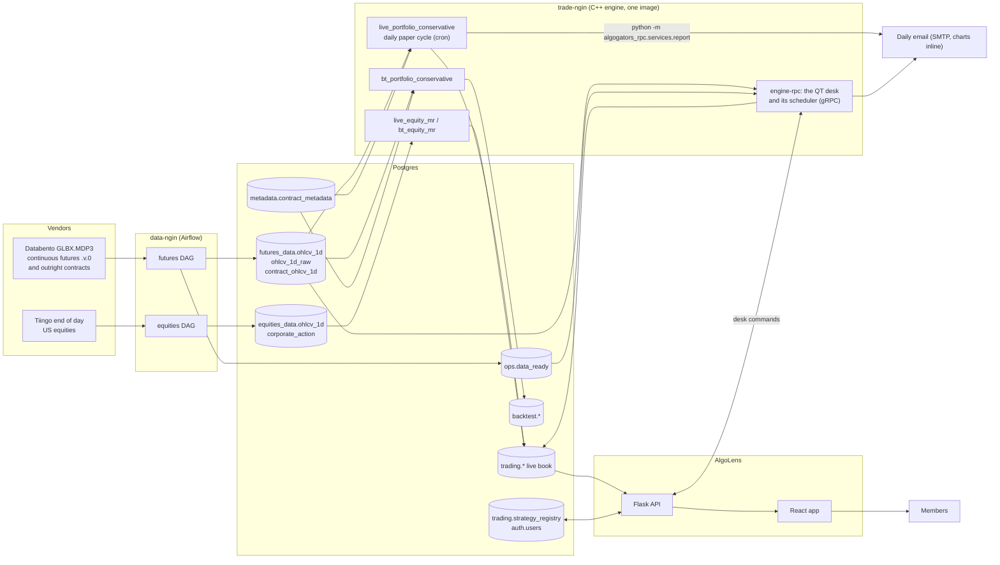
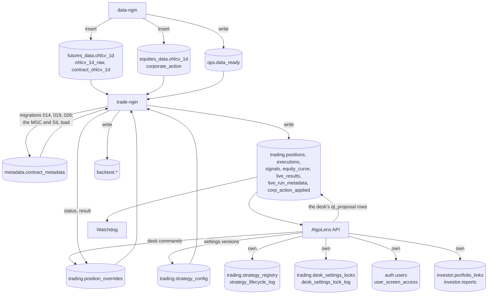
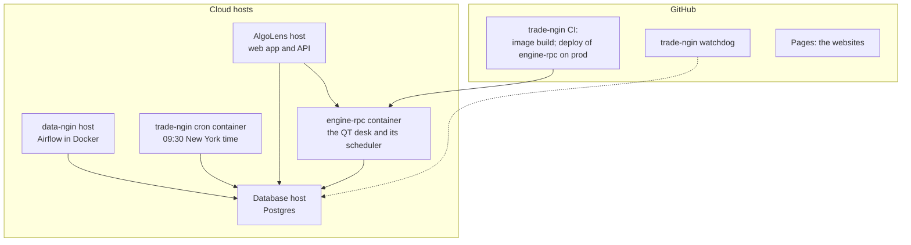

# System architecture

What the AlgoGators system is made of, what each part does, and how the parts connect. The parts
live in one repository, AlgoGators/algogators: the engine, trade-ngin, is `services/trade-ngin/`,
and the data pipeline, the dashboard and the libraries sit beside it (section 5). The engine is
described in most detail and every statement about it is checked against its code. The other parts
are described at the level of what they are and what they read and write; their own READMEs are the
authority for anything deeper.

Specialised documents carry the detail this map only points at:

| Topic | Document |
|---|---|
| Which tables and columns to read, and which never to read | [DATA_SOURCES_OF_TRUTH.md](DATA_SOURCES_OF_TRUTH.md) |
| The daily live run, its dates, its tables and its running instructions | [LIVE_RUN_CYCLE.md](LIVE_RUN_CYCLE.md) |
| The trend-following method end to end | [TREND_FOLLOWING_SYSTEM.md](TREND_FOLLOWING_SYSTEM.md) |
| The futures rebalance: sizing capital, overlay, the one pass | [OPTIMIZER_AND_RISK_DESIGN.md](OPTIMIZER_AND_RISK_DESIGN.md) |
| Risk modules and `risk.json` | [RISK_MODULES.md](RISK_MODULES.md) |
| Contract rolls and the back-adjusted series | [FUTURES_ROLLS.md](FUTURES_ROLLS.md) |
| What a fill costs, fees and netting | [COST_MODEL.md](COST_MODEL.md) |
| Configuration files | [CONFIG_GUIDE.md](CONFIG_GUIDE.md) |
| Operations: schedule, exit codes, logs, migrations | [performance_upkeep.md](performance_upkeep.md) |
| Equity cost basis and corporate actions | [AVERAGE_PRICE_LIFECYCLE.md](AVERAGE_PRICE_LIFECYCLE.md), [CORP_ACTIONS_DATA_BOUNDARY.md](CORP_ACTIONS_DATA_BOUNDARY.md), [BROKER_BASIS_RECONCILIATION.md](BROKER_BASIS_RECONCILIATION.md) |
| The QT desk and the engine's gRPC server | [design/desk-service.md](design/desk-service.md), [design/rpc.md](design/rpc.md), [design/qt-contract.md](design/qt-contract.md) |

Contents

1. The system in one picture
2. data-ngin: the data pipeline
3. The database
4. trade-ngin: the engine
5. The other parts
6. How the pieces connect

---

## 1. The system in one picture

The fund runs on four things: a data pipeline, one Postgres database, a C++ engine and a dashboard.
Everything else is a tool, a library or a website.

Satellites, none of which touch the database above:

| Part | Where | What it is |
|---|---|---|
| algosystem | `libs/algosystem/` | Python library: tearsheets and overfitting statistics on an equity series |
| AlgoTerminal | `apps/algoterminal/` | Python terminal workbench for research on free public data |
| algogauge | its own repository, AlgoGators/algogauge | benchmark and profiling suite that compiles trade-ngin as a git submodule |
| the websites | `apps/website/` (the public site) | a public marketing site and a training curriculum site, both static |

A day in the system:

| When | What runs | Where | Reads | Writes |
|---|---|---|---|---|
| early morning, before the engine (the futures pull at 04:30 New York time) | the futures and equities DAGs | data-ngin (Airflow) | the vendors | `futures_data.ohlcv_1d`, `ohlcv_1d_raw`, `contract_ohlcv_1d`; `equities_data.ohlcv_1d`, `ohlcv_1d_raw`; `ops.data_ready`, the pull's "ready" record |
| every day, by default every 5 minutes from 06:30 to 10:30 New York time and every 30 minutes to 22:00 | the QT desk's catch-up scheduler: the model run once the data is ready, the 09:30 send, the 10:00 fallback | `engine-rpc` (section 4.8) | bars, metadata, `ops.data_ready`, the desk's settings and commands | the QT books' `trading.*` rows, their e-mail |
| 09:30 America/New_York, every calendar day | `scripts/run_live_portfolio.sh`, which runs `live_portfolio_conservative <date> --send-email` | the trade-ngin cron container | bars, metadata, the stored book | `trading.*`, the email, CSV files, logs |
| 15:00 UTC, every day | the watchdog workflow | GitHub Actions | `trading.live_results`, `trading.positions`, `trading.live_run_metadata` | a GitHub issue when the book was not written or a run is marked |
| on demand | AlgoLens | its own host | `trading.*`, the registry | the registry and its lifecycle log |
| on demand | the backtest runners | a developer machine | bars, metadata | `backtest.*`, CSV files |

"Live" means a daily paper cycle. There is no broker connection anywhere in the system: fills are
synthesised from the change in the book and priced at a stored close (section 4.6).

---

## 2. data-ngin: the data pipeline

**What it is.** `services/data-ngin/` of the AlgoGators repository. A Python pipeline with four
configurable stages (loader, fetcher, cleaner, inserter) driven by one YAML file per feed. Each YAML names the classes to load, the vendor, the symbol list,
the target `schema.table` and a date range. One Airflow DAG per feed wraps the pipeline run.

**Vendors and datasets.**

| Vendor | What it delivers | Target |
|---|---|---|
| Databento Historical, dataset `GLBX.MDP3`, schema OHLCV-1D, continuous symbology | one daily bar per root of the continuous symbol `ROOT.v.0` (for example `ZN.v.0`) | `futures_data.ohlcv_1d` and `ohlcv_1d_raw` |
| the same dataset, outright contracts | one daily bar per listed contract, with its expiration | `futures_data.contract_ohlcv_1d` |
| Tiingo end of day | daily OHLCV, the vendor's adjusted OHLCV, `div_cash` and `split_factor` per symbol | `equities_data.ohlcv_1d` and `ohlcv_1d_raw` |
| none (synthetic series) | test series | `synthetic.ohlcv_1d` (not present in every copy of the database; nothing in trade-ngin reads it) |

**Transformations.**

- Futures. `.v.0` is the vendor's volume-ranked front-contract resolver: each day's bar is the bar
  of whichever listed contract ranked first by volume, at that contract's own traded prices.
  Nothing is back-adjusted upstream, by the vendor or by the pipeline. On the day the resolver
  switches contract the stored close steps by the price gap between two contracts, which is not a
  return. The engine, not the pipeline, builds the back-adjusted series every return consumer reads
  (the design comment at `include/trade_ngin/data/roll_series.hpp`, and
  [FUTURES_ROLLS.md](FUTURES_ROLLS.md)). The contract behind each bar is the `instrument_id` column
  of `ohlcv_1d_raw`. With `per_contract_rolls` on, the engine reads the held contract's own bars
  from `contract_ohlcv_1d` on the dates of the vendor's series and decides the rolls itself
  (`include/trade_ngin/data/contract_roll_rule.hpp`, `include/trade_ngin/data/per_contract_source.hpp`).
- Futures symbols. The four equity index roots are stored under the micro symbols (`MES.v.0`,
  `MNQ.v.0`, `MYM.v.0`, `M2K.v.0`); the price history is the index contract's, and the engine
  decides which contract size the book trades on each date (section 4.3).
- Equities. The vendor's raw and adjusted columns are stored as delivered. The engine does not read
  the vendor's adjusted columns: it rebuilds the adjustment from `div_cash` and `split_factor`
  (the comment at `include/trade_ngin/data/market_data_utils.hpp`).
- Calendars. The pipeline keeps its own per-product calendar for its pulls
  (`services/data-ngin/src/data_ngin/application/trading_calendar.py`); the engine does not read it.
  The engine carries its own files: `include/trade_ngin/core/holidays.json` (the NYSE's) and
  `include/trade_ngin/core/futures_holidays.json` (CME Group's, per product group, for the roll
  rule).
- The ready record. After a pull the pipeline writes `ops.data_ready` (migration 028): which
  dataset and bar date is loaded, how many symbols were expected and loaded. The QT desk's model
  run waits for it.

**Storage.** Plain inserts. `futures_data.ohlcv_1d_raw` has a primary key (`ts_event`, `symbol`)
and holds one row per symbol and day. `futures_data.ohlcv_1d` held repeated rows; with the
primary key (`time`, `symbol`) (AlgoGators/algogators#24) a re-load cannot store a symbol and day
twice, and the engine's loader keeps one row per symbol and day on any copy. Its database connection comes from its own environment.

What to read from these tables, the duplicate rows in `futures_data.ohlcv_1d` and the loader rule
that removes them are in [DATA_SOURCES_OF_TRUTH.md](DATA_SOURCES_OF_TRUTH.md).

---

## 3. The database

One PostgreSQL instance is the integration bus between the pipeline, the engine and the dashboard.
No service calls another: each reads and writes tables. Credentials come from each service's
environment or, for the engine, from the untracked `config/` directory (section 4.7).

| Schema | Tables the system uses | Written by | Schema changes in this repository |
|---|---|---|---|
| `futures_data` | `ohlcv_1d` (the bars the engine loads), `ohlcv_1d_raw` (one row per symbol and day, with `instrument_id`), `contract_ohlcv_1d` (one row per listed contract and day, with `expiration`; read with `per_contract_rolls` on) | data-ngin; the futures release's load of the MGC and SIL rows (`scripts/futures_release/`) | none |
| `ops` | `data_ready` (the pull's "ready" record) | data-ngin | `028` creates the schema and the table |
| `equities_data` | `ohlcv_1d`, `ohlcv_1d_raw`, `corporate_action`, `ticker_aliases`, and coverage tables | data-ngin | `003` adds query indexes |
| `metadata` | `contract_metadata` (one row per futures contract: multiplier, tick, margins, hours, months, `"Fee Per Contract"`) | maintained by hand, by migrations and by the futures release's load of the MGC and SIL rows (`scripts/futures_release/load/load_micro_metals.sql`) | `014` adds `"Fee Per Contract"`, `019` corrects rows, `026` sets the per-contract IBKR fees with a CHECK |
| `trading` | `positions`, `executions`, `signals`, `equity_curve`, `live_results`, `live_run_metadata`, `strategy_trading_days_metadata`, `corp_action_applied`; function `get_trading_days` | trade-ngin live runners | `001` `portfolio_type`; `002`, `005`, `006` `corp_action_applied`; `004` `get_trading_days`; `012` `strategy_id` width; `013` `executions.netting_adjustment`; `015` `executions.execution_type` and `instrument_id`; `016` `positions.instrument_id`; `017` `live_results` roll costs; `020` `live_results.risk_detail`; `034` column comments; `035` `live_results.settled_at`; `036` `live_results` statistics and overlay columns; `040` the roll split on `executions`; `041` the book e-mail's columns on `positions` and `live_results` |
| `trading` | `strategy_config` (the desk's settings), `position_overrides` (the desk's command log), the QT books' rows in the tables above | the QT desk (`engine-rpc`) and AlgoLens | `021` to `025`, `027`, `029` |
| `trading` | `strategy_registry`, `strategy_lifecycle_log` | AlgoLens | `023` adds `strategy_registry.portfolio_group` and `desk_editable` and the two QT portfolios' rows (the engine reads desk editing from the portfolio's `portfolio.json`, `qt.desk_editable`, not from this column) |
| `trading` | `desk_settings_locks` (the settings the desk may not change, one path per row), `desk_settings_lock_log` (every lock and unlock, append-only) | AlgoLens (`services/research-api/src/research_api/infrastructure/qt/repositories.py`); the engine does not read them | none here: AlgoLens's own migration `services/research-api/migrations/004_desk_settings_locks.sql` creates both |
| `backtest` | `run_metadata`, `results`, `equity_curve`, `final_positions`, `executions`; `signals` (present, never written) | trade-ngin backtest runners | `013`, `015` on `executions`; `016` `final_positions.instrument_id`; `018` `results` cost columns; `020` `equity_curve.risk_detail`; `034` column comments; `037` `results` statistics columns and `equity_curve` overlay columns; `038` `final_positions.row_mark`; `039` `end_date` comments; `040` the roll split on `executions` and its totals on `results` |
| `auth` | `users`; `user_screen_access` (the screens, member, investor and qt, an admin grants each user) and its append-only log `screen_access_log` | AlgoLens; the engine does not read them | none here: AlgoLens's own migration `services/research-api/migrations/003_screen_access.sql` creates `user_screen_access` and its log |
| `investor` | `portfolio_links` (the portfolio, and the book of it, the desk's or the model's, each investor follows) and its append-only log `portfolio_link_log`; `reports` (the reports an admin uploads for the investor screen) | AlgoLens; the engine does not read them | none here: AlgoLens's own migrations `services/research-api/migrations/005_investor_portfolio_links.sql` (`portfolio_links` and its log) and `003_screen_access.sql` (the schema and `reports`) |
| `reports` | `report_queue` (the queue of AlgoLens's retired report worker; the book e-mail is the engine's Python report, and no code on `main` reads or writes the queue) | AlgoLens's table | none here: AlgoLens's own migration `services/research-api/migrations/006_report_queue.sql` |
| `synthetic` | `ohlcv_1d` (not present in every copy of the database; nothing in trade-ngin reads it) | data-ngin | none |
| `macro_data` | macro series | not by the engine; no runner reads it | none |

The migrations in `migrations/` are numbered 001 to 006, 012 to 029 and 034 to 041 (`migrations/README.md`
lists them in order); each file's header is its specification and each has a rollback file beside it,
except 024, which cannot be undone. The core tables of `trading`, `backtest`,
`metadata` and `futures_data` predate the migrations: no migration creates them (the migration
test scripts build throwaway copies only), so the migrations only alter them. What one row of each
table is, its key and when it is final are in [LIVE_RUN_CYCLE.md](LIVE_RUN_CYCLE.md).

The bar table name is `{asset}_data.{data_type}_{frequency}` (`build_table_name`,
`include/trade_ngin/core/types.hpp`); the futures `_raw` twin is named by
`kFuturesRawBarTable` (`include/trade_ngin/data/market_data_utils.hpp`). The CI job "schema
ownership guard" (`.github/workflows/svc-trade-ngin.rpc.yml` of the AlgoGators repository) fails a change that adds, in
`src/data` or `src/storage`, a string literal beginning with `futures_data.`, `equities_data.`,
`options_data.`, `synthetic.`, `auth.` or `research.`. It is a pattern check on those two
directories: a schema named in the middle of a query, as the engine's read queries name
`equities_data`, is not matched.

Columns the engine stores that later sections refer to:

| Column | Where | Meaning |
|---|---|---|
| `execution_type` | `trading.executions`, `backtest.executions` | `STRATEGY` (a fill against the day's target), `ROLL` (one leg of a contract roll) or `BORROW` (the backtest's overnight borrow-fee row); `ExecutionType`, `include/trade_ngin/core/types.hpp` |
| `instrument_id` | the executions tables, `trading.positions`, `backtest.final_positions` | the vendor contract id: on a ROLL leg the contract that leg traded, on a position the contract held |
| `netting_adjustment` | the executions tables | the part of a sleeve fill's own cost the account did not pay because sleeves traded the same symbol on the same day (section 4.6) |
| `risk_scale`, `risk_detail` | `trading.live_results`, `backtest.equity_curve` (`risk_detail`) | the rebalance's record: nine keys built by `risk_detail_json`, `include/trade_ngin/risk/risk_detail.hpp` (`risk_requested`, `binding_term`, `overlay_blind`, `sizing_capital`, `account_value`, and the four `over_limit_*` keys) |
| `overlay_risk`, `overlay_risk_jump`, `overlay_risk_shock`, `overlay_gross_leverage`, `overlay_net_leverage`, `var_95_1d` | `trading.live_results`, `backtest.equity_curve` | the overlay's readings of the stored book, on futures rows of a sized rebalance; the three risk readings and `var_95_1d` are NULL on a blind window |
| `daily_roll_costs`, `total_roll_costs` | `trading.live_results` | the cost of ROLL legs, counted apart from strategy turnover |
| `transaction_costs`, `roll_costs`, `total_roll_fills` | `backtest.results` | the run's cost totals and its count of ROLL fills |
| `portfolio_config` | `trading.live_run_metadata` | the run's configuration as JSON, and the marks of a refused day (section 4.5) |

---

## 4. trade-ngin: the engine

### 4.1 What it is

One shared library, `trade_ngin` (`CMakeLists.txt`), plus seven runner executables, two tools and a
benchmark executable, a Python module (`tradengin`, `python/`) that wraps the backtest, and the
gRPC server `engine-rpc` (`services/rpc/`, section 4.8). It loads bars from Postgres, runs the strategies, sizes and rebalances a
portfolio in whole contracts under a risk overlay, synthesises the fills, and writes the book, the
fills, the P&L and the statistics back to Postgres. C++20, CMake.

### 4.2 Module map

Headers are under `include/trade_ngin/<module>/`, sources under `src/<module>/`. The design
comments at the top of the headers named here are the reference for each piece; this table only
says where to look.

| Module | Role | Start reading at |
|---|---|---|
| `core/` | layered JSON configuration (`config_loader`), logger, `holiday_checker` with `holidays.json` (the CME calendar `futures_holidays.json` sits beside it and is read by `data/roll_calendar`), `time_utils`, `types.hpp` (bars, positions, execution reports, asset class to schema), the report text helpers and the rule for a statistic with no value. `config_manager` and `config_version` (an environment and version framework for configuration) are compiled and used only by their tests: no runner loads its configuration through them | `include/trade_ngin/core/config_loader.hpp` (`require_loop_keys`), [src/core/README.md](../src/core/README.md) |
| `data/` | `postgres_database` (every SQL read and write, libpqxx to Arrow tables), `credential_store`, `market_data_bus`, `market_data_utils` (the futures bar query that keeps one row per symbol and day; the equity adjustment), `session_classifier`, `roll_series`, `listing_dates` | `include/trade_ngin/data/market_data_utils.hpp` (`kFuturesBarKeepOrder`) |
| `data/session_classifier` | what one symbol's bar, or its absence, is on one date: `SESSION`, `JUNK`, `NO_BAR_CLOSURE`, `NO_BAR_FEED_HOLE`. Only a `SESSION` symbol updates its signal and may trade; the others are held | `include/trade_ngin/data/session_classifier.hpp` (`SessionVerdict`) (`SessionClassifier`) |
| `data/roll_series` | the contract switches of a symbol's consumed bars (change, confirm, flip), the back-adjusted level and return series, and the two ROLL legs of a confirmed roll | `include/trade_ngin/data/roll_series.hpp` (`build_series`) (`make_roll_legs`) |
| `data/listing_dates` | a contract that lists on a date, the contract the book trades before it, and vendor id relabels that are not rolls (not read with `per_contract_rolls` on) | `include/trade_ngin/data/listing_dates.hpp` (`ListedContract`) (`ListingDates`) |
| `data/` per-contract rolls | with `per_contract_rolls` on: the contract bars (`contract_bars`), the roll rule (`contract_roll_rule`: the deadline, the five-trading-day window, the volume crossover, the vendor's confirmed switch, the cycle front month), the roll cycle per root (`roll_cycle`), the exchange calendars (`roll_calendar`), the series per root (`contract_rolls`) and the bar source that hands the held contract's bars to every loader (`per_contract_source`) | `include/trade_ngin/data/contract_roll_rule.hpp`, `include/trade_ngin/data/per_contract_source.hpp` |
| `api/` | the backtest entry points the Python module `tradengin` wraps (`python/`) | `python/README.md` |
| `instruments/` | `instrument_registry` loads `metadata.contract_metadata` and resolves a symbol to its row (the `.v.` suffix is stripped); futures, equity and option specifications; the equity margin rule (an equity is held in a cash account, paid in full) | `src/instruments/instrument_registry.cpp` (`get_instrument`), [src/instruments/README.md](../src/instruments/README.md) |
| `strategy/` | `base_strategy`, `trend_following` with `trend_estimator` (volatility and the EWMAC forecasts from a fixed trailing window), `mean_reversion`, `equity_strategy_builder`, `sleeve_config` (a futures sleeve's required keys). `regime_detector` is compiled and used by no runner | `include/trade_ngin/strategy/trend_following.hpp`, `include/trade_ngin/strategy/mean_reversion.hpp` |
| `portfolio/` | `portfolio_manager` (holds the sleeves, runs the rebalance), `sizing_capital` (the capital the futures book is sized on), `allocation_split` (one symbol's contracts split back to the sleeves), `loop_config` | `src/portfolio/portfolio_manager.cpp` (`rebalance_one_pass`) |
| `optimization/` | `one_pass` (the futures rebalance as pure functions: cap, covariance, forecast-sign close, search from the held book, buffer, rounding, trim) and `dynamic_optimizer` (the greedy whole-contract optimiser of the generic step, which runs only for a book that holds no trend sleeve and sets `use_optimization`; a book that holds a trend sleeve and names no overlay sleeve is refused, `src/portfolio/portfolio_manager.cpp`) | `include/trade_ngin/optimization/one_pass.hpp` (`rebalance`) |
| `risk/` | `overlay` (the overlay's arithmetic: the gate window, five readings, one multiplier), `risk_module` (the module interface and its actions), `carver_risk_module`, `basic_risk_modules` (constant scale, warn, refuse), `risk_module_config` (`risk.json` schema 2), `risk_detail`, `risk_manager` (the measurement behind the reported risk columns) | `include/trade_ngin/risk/overlay.hpp` (`Readings`), `include/trade_ngin/risk/risk_module.hpp` (`RiskModule`) |
| `transaction_cost/` | spread and impact models, per-asset cost configuration, `transaction_cost_manager`, `netting` (the adjustment between sleeves and the cost after netting) | `include/trade_ngin/transaction_cost/netting.hpp` (`net_cost`) |
| `backtest/` | `backtest_coordinator` (the daily loop), data loader, execution, P&L and price managers, metrics, CSV export, the equity cost helpers | `src/backtest/backtest_coordinator.cpp` (`run_portfolio`) (`process_portfolio_day`) |
| `live/` | `live_trading_coordinator`, `live_daily_cycle` and `live_data_loader`, `execution_manager` (paper fills), `execution_price_resolver`, `live_pnl_manager`, `margin_manager`, `session_book_gate`, `live_roll_legs`, `futures_cost_feed`, `live_sizing_read`, `stored_book_ownership`, `risk_module_failure` and `run_metadata_marks`, `python_mail` (runs the book e-mail module), `qt_desk` (the QT desk's modes of the futures runners), the corporate-actions applier, lifecycle, classification and audit log, `broker_frame`, `csv_exporter`, the live metrics | `include/trade_ngin/live/session_book_gate.hpp`, `include/trade_ngin/live/live_trading_coordinator.hpp` |
| `storage/` | `backtest_results_manager` and `live_results_manager` on a shared base (`results_manager_base`): map a run's output onto `backtest.*` and `trading.*`; the live manager refuses an equity-curve value it cannot hold | `include/trade_ngin/storage/live_results_manager.hpp`, [src/storage/README.md](../src/storage/README.md) |
| `statistics/` | statistical tests, regressions, state estimation, volatility models, transformers. A library; the runners' stored statistics come from the backtest and live metrics calculators | `src/statistics/README.md` |
| `order/`, `execution/` | an order state machine and an execution-algorithm engine. Neither is used by a runner (`include/trade_ngin/execution/execution_engine.hpp`) | |

### 4.3 Strategies and portfolios

| Strategy class | Used by | What it does |
|---|---|---|
| `TrendFollowingStrategy` | the futures books | trend following on exponentially weighted moving-average crossovers, sized to a volatility target. One class serves every trend sleeve; the configuration type `TrendFollowingFastStrategy` is the same class on a faster set of pairs. The method is in [TREND_FOLLOWING_SYSTEM.md](TREND_FOLLOWING_SYSTEM.md) |
| `MeanReversionStrategy` | the equity book | a z-score of the close against its moving average, with entry and exit thresholds and a stop. |

Portfolios are directories under `config_template/portfolios/` (`portfolio.json`, `risk.json`,
`email.json`), copied to the untracked `config/` for a run:

| Portfolio | Capital | Sleeves | Notes |
|---|---|---|---|
| `CONSERVATIVE_PORTFOLIO` | 500,000 | `TREND_FOLLOWING` at allocation 1.0: six EMA pairs from (2, 8) to (64, 256), risk target 0.20, IDM 2.5 | the book the scheduled cron job runs |
| `QT_CONSERVATIVE_PORTFOLIO` (template `qt_conservative`) | 500,000 | the trend sleeve | the desk's book (desk editing on), and the only book `engine-rpc`'s scheduler runs: `QT_CATCHUP_PORTFOLIOS` defaults to `qt_conservative` (`deploy/engine-rpc.compose.yml`, section 4.8) |
| `QT_CONSERVATIVE_MODEL_PORTFOLIO` (template `qt_conservative_model`) | 500,000 | the trend sleeve | the model twin of the desk's book (desk editing off), retired: no longer scheduled, and `scripts/qt_oneoff/d1_retire_model_twin.sql` marks its registry row inactive; its stored rows are kept |
| `QT_E2E_PORTFOLIO` (template `qt_e2e`) | 500,000 | the trend sleeve | a test book for the end-to-end desk script `scripts/qt_e2e.sh`; not scheduled and not in the registry |
| `BASE_PORTFOLIO` | 500,000 | `TREND_FOLLOWING` at 0.7 and `TREND_FOLLOWING_FAST` at 0.3 (four pairs, risk target 0.25) | the repository's base template, `config_template/portfolios/base/`, with two sleeves; the only book where sleeves net against each other |
| `EQUITY_MR_PORTFOLIO` | 100,000 | `MEAN_REVERSION` on a listed set of tickers | no optimiser; its `risk.json` declares the module type `none` with a reason |

The futures universe is every symbol in `futures_data.ohlcv_1d`, less any `.c.0` symbol and
`ES.v.0`, which the runners drop from the list
(`apps/strategies/live_portfolio_conservative.cpp`), and less each predecessor whose listed
contract is stored too (`ListingDates::run_universe`). Optional keys of a futures `portfolio.json`
change what a symbol is or runs (`src/core/config_loader.cpp`); the conservative template carries
the first four:

- `per_contract_rolls` (`true` in the shipped templates, off when absent). The futures bars are
  the held contract's own, from `futures_data.contract_ohlcv_1d`, and the engine rolls by its own
  rule instead of following the vendor's series. [FUTURES_ROLLS.md](FUTURES_ROLLS.md) describes it.
- `listing_dates`. The four equity index micros (MES, MNQ, MYM, M2K) trade only from their listing
  date, 2019-05-06. Before it the book trades the E-mini (ES, NQ, YM, RTY: ten times the size, its
  own fee and margin row) on the same price history, and a backtest that spans the date switches
  on it with fills whose ids begin `LC-` and `LO-`. The gold and silver micros, MGC from 2010-10-04
  and SIL from 2013-06-17, are declared the same way, with GC and SI before them (ratios 10 and
  5); this pair needs `per_contract_rolls` on and the MGC and SIL series stored, or the run is
  refused. A live run trades no predecessor.
- `instrument_id_relabels`. Dated vendor id changes that are not rolls: the same contract under a
  new id. No change bar, no ROLL legs. Not read with `per_contract_rolls` on, where the rule rolls
  each change itself.
- `trading_rule_removals`. Per contract, the fastest EMA pairs that contract does not run because
  the rule's yearly cost on it is too high: eighteen rules on twelve contracts. A listed contract
  runs the pairs left at equal weight.
- `carry`. A carry forecast blended with the trend forecast; the shipped templates carry no
  `carry` block, so it is off, and it needs `per_contract_rolls` on
  (`config_template/README.md`).

### 4.4 The futures rebalance at a glance

Each stage has its own document; this is the order the engine runs them in.

1. **Bars.** One bar per symbol and day is kept from `futures_data.ohlcv_1d`, with the contract id
   of that print from `ohlcv_1d_raw`; with `per_contract_rolls` on, the bar on each of those dates
   is the held contract's own, from `contract_ohlcv_1d`. The session classifier gives each symbol a
   verdict for the day; a symbol that is not `SESSION` is held and its withheld bar is never fed to
   a signal.
2. **Two series.** Returns, volatility and the trend signal read the back-adjusted series built by
   `roll_series`. Every level (sizing, notional, costs, margin, the risk readings) reads the real
   contract price. On the vendor's series a symbol is held through a change bar and a confirmed
   roll books two `ROLL` fills on the confirming bar; with `per_contract_rolls` on, a roll the rule
   knows on its bar is booked on that bar at its two closes, and the bar books the old contract's
   move. See [FUTURES_ROLLS.md](FUTURES_ROLLS.md).
3. **Forecast and target.** Each sleeve computes its forecast and an unrounded target in
   contracts. On the first sleeve, a negative combined forecast on the equity index symbols stands
   only when the slow pairs named in `equity_slow_rule` are negative too.
4. **Sizing capital.** The book is sized on the half-compounded capital: the starting capital less
   the drawdown of the cumulative settled net P&L from its running peak, never above the starting
   capital (`half_compounded_capital`, `include/trade_ngin/portfolio/sizing_capital.hpp`).
   `sizing_mode` and `starting_capital` are required keys of a futures book and are checked when
   the configuration loads; neither is read by the sizing, which takes `initial_capital`
   (`starting_capital` must equal it, and `sizing_mode` accepts the one value `half_compounding`).
5. **The one pass.** A book that names an overlay sleeve is rebalanced by one pass and by no other
   optimiser or risk step (`one_pass_book`, `src/portfolio/portfolio_manager.cpp`): the cap on
   each name's target, the overlay once, the forecast-sign close, the whole-contract search from
   the held book with its cost weight, the buffer and the rounding, the clip to the cap, the trim,
   then the split back to the sleeves. See
   [OPTIMIZER_AND_RISK_DESIGN.md](OPTIMIZER_AND_RISK_DESIGN.md).
6. **The overlay.** Five readings of the capped target book in capital terms: `R` (portfolio
   risk), `R_jump`, `R_shock`, `L_g` (gross leverage) and `L_n` (net leverage). Each is compared
   with its limit; the smallest ratio of limit to reading, never above 1, is applied once as one
   multiplier
   (`multiplier`, `include/trade_ngin/risk/overlay.hpp`). The limits are the keys of the
   `carver` module in `risk.json`. See [RISK_MODULES.md](RISK_MODULES.md).
7. **Risk modules.** `risk.json` (schema 2) declares the modules of a book: `carver`,
   `constant_scale`, `warn`, `refuse` or `none`. A module answers with one action
   (`RiskAction`, `include/trade_ngin/risk/risk_module.hpp`). A module that cannot answer
   refuses its scope: the book is held, nothing trades and the day is still stored.
8. **Fills and costs.** Section 4.6.

The equity book runs none of this: one sleeve, fractional shares, no optimiser, and corporate
actions applied inside its daily cycle ([AVERAGE_PRICE_LIFECYCLE.md](AVERAGE_PRICE_LIFECYCLE.md)).

### 4.5 Runners

All under `apps/`. Every runner resolves `./config` from the directory it is started in.

| Executable | Source | What it does |
|---|---|---|
| `live_portfolio_conservative` | `apps/strategies/live_portfolio_conservative.cpp` | one dated daily cycle of `CONSERVATIVE_PORTFOLIO`; the scheduled job |
| `live_portfolio` | `apps/strategies/live_portfolio.cpp` | the same cycle for `BASE_PORTFOLIO` |
| `live_equity_mr` | `apps/strategies/live_equity_mean_reversion.cpp` | the daily cycle of the equity book, including corporate actions |
| `bt_portfolio_conservative`, `bt_portfolio` | `apps/backtest/` | futures backtests through `BacktestCoordinator`, stored to `backtest.*` and CSV |
| `bt_equity_mr` | `apps/backtest/bt_equity_mean_reversion.cpp` | the equity backtest |
| `bt_equity_validation` | `apps/backtest/bt_equity_validation.cpp` | runs the equity backtest on the last 180 days of its symbols' bars and recomputes its data, signals, P&L and metrics independently. It is not a pure recompute: it stores the run's daily `backtest.final_positions` rows (portfolio `equity_validation`, strategy `VALIDATION_MR`) and no `backtest.results` row. The run id is the strategy and the last bar date, so a second run before a new bar arrives is refused (exit 1) until the first run's rows are deleted (`include/trade_ngin/backtest/stored_run_refusal.hpp`) |
| `qt_settings_check` | `apps/tools/qt_settings_check.cpp` | a tool: whether a desk settings change would be accepted by a live run |
| `contract_rolls_dump` | `apps/tools/contract_rolls_dump.cpp` | a tool: the per-contract roll rule's held series per root, as CSV, read only. Unlike the runners it reads no `./config`: the database is the connection string in `CONTRACT_ROLLS_DSN`, and the usage is `contract_rolls_dump <out.csv> [end YYYY-MM-DD] [root ...]` |

`apps/test_database_extensions.cpp` is an old test program that no CMake target builds.

The two futures live runners also run the QT desk's modes, which `engine-rpc` starts
([design/desk-service.md](design/desk-service.md) describes them): `--desk`, `--override`,
`--publish` and `--fallback` (each with `--audit-id`, the command row), `--send` (the 09:30
e-mail of a published day), `--finalize-system` (finalises the system book's previous day before
the model run of a desk-editable book; it writes nothing else and never e-mails), and
`--send-now` (with `--publish` or `--fallback` only: send the e-mail in the same run). Each mode
needs the run date, and `--portfolio-config` names the directory under `config/portfolios`. A run takes one
mode; two are refused with exit 1. Only `live_portfolio_conservative`, the binary the desk runs by
default, checks the fund's margin cap on a desk book (contract C11 of
[design/qt-contract.md](design/qt-contract.md)).

A live futures run takes `YYYY-MM-DD [--send-email]`, the date positionally or as `--date`
(`apps/strategies/live_portfolio_conservative.cpp`); two different dates are refused with exit 1
(`include/trade_ngin/live/run_args.hpp`). The equity runner takes the date only positionally and,
given two, keeps the later one without a warning. A run with no date runs nothing and exits 2. A
run given the date T loads bars through T-1, prices its fills at the T-1 close, stores rows dated T
and finalises the T-1 row. The scheduled run always passes a date. What a run takes from the
host's clock is in [LIVE_RUN_CYCLE.md](LIVE_RUN_CYCLE.md).

The exit codes of the runners and of the wrapper, and what each can leave stored:

| Exit code | When it happens | What it can leave stored |
|---|---|---|
| 0 | A futures live runner (`live_portfolio`, `live_portfolio_conservative`) reaches the end of the run with the book not refused by the risk step, no sizing hold, and its book e-mail, when the run sends one, sent. Three cases share this code: a completed day; a carried day (no symbol has a consumed bar for the previous day, so the whole book is carried and no order is made); a run in which a store failed, was logged and was passed over. A refusal by the risk step never ends at 0: see the rows for 3 and for 1 after the `live_run_metadata` row. | A completed day: the `live_run_metadata` row, the signals, the executions, the settled rows of the previous day, the day's positions, the day's `live_results` row and its equity point. A carried day: the same without signals; the book is unchanged, so no order is made. A passed-over failure: the day without the table whose store failed, which can be the `live_run_metadata` row, the signals, the executions of a sleeve that has no roll leg, the previous day's positions, the day's positions, the previous day's equity point, or the day's `live_results` row and equity point. Exit 0 is not proof that the day is stored in full: the evidence of a completed day is the date's `trading.live_results` row. |
| 0 | The wrapper `scripts/run_live_portfolio.sh` finds its lock directory present and skips. The binary is not started. | Nothing. |
| 1 | A futures live runner refuses before it writes the day's `live_run_metadata` row: a bad argument; a logger that cannot be initialised; a config, database or instrument registry failure; a missed previous run; a listing-date refusal; missing margin metadata; a sleeve that cannot be built or started; bars that cannot be loaded; a feed in which no symbol has a usable bar date; a holiday calendar that is not loaded or does not cover the run date or the day before it; with `per_contract_rolls` on, a futures roll calendar that cannot be loaded; a held symbol with no bar for longer than the tolerance on a run for the host's date; roll state that cannot be read or placed; a stored book the run does not load; a sleeve book the sizing read cannot load; a sizing capital the portfolio manager rejects. | Nothing. |
| 1 | A futures live runner stops after it wrote the day's `live_run_metadata` row. | It depends on where the run stops. The estimator history cannot be seeded, or the portfolio step fails: the `live_run_metadata` row (marked `risk_refusal` when a sizing hold was recorded first, when the portfolio step failed because the risk step refused a book that has no stored previous positions to be held at, or, with scope `sleeve`, when a sleeve risk module or the sleeve's risk step could not answer on a sleeve that has no stored previous positions). A roll leg has no usable close, executions cannot be generated with a roll owed, the strict assertion fails (the row is marked `strict_assertion`), the netting refuses a row, or the day's roll executions cannot be stored: the row and the day's signals. The margin calculation fails: the row, the signals, the executions and the rewritten positions of the previous day. The previous day's `live_results` row cannot be updated: the row, the signals, the executions and both days' positions; the previous day's `live_results` row and equity point are left as they were. The previous cumulative roll cost cannot be read: a half-written day, with the executions, both days' positions and the previous day's settled `live_results` row and equity point stored, and no `live_results` row for the day. Any other error: whatever was written before it. |
| 2 | A live runner (`live_portfolio`, `live_portfolio_conservative`, `live_equity_mr`) is started with no date. It prints the usage and runs nothing. The wrapper always passes a date. | Nothing. No email is sent. |
| 2 | A futures live runner in one of the desk's modes refuses the command (`QT_REFUSED` in the log), for example: the command row is already finished, or is of another kind, portfolio or date; the book is not desk-editable; the override decision cannot be checked; the day is published and so frozen; yesterday's desk book is missing or an earlier day is unpublished; there is no proposal or no desk book to act on; the desk's book is over the fund's margin cap. A desk run that fails rather than refuses (a read or a store that did not happen, `QT_FAILED`) exits 1, and so do the model run's own desk refusals (yesterday's desk book missing, an earlier day not published). | The command row marked `refused`, except when it was already finished. A desk or override run refused at the margin cap has already stored the day's desk book, left unmarked so that it cannot be published. |
| 3 | Futures live runners only. The risk step refused the book, or the sizing read failed with every sleeve book loaded. The risk step refuses the book when the one pass cannot produce its answer (the overlay sleeve is not running, a held symbol that cannot be weighed has no usable close or multiplier, an input or an overlay reading is not a finite number, the pass fails), and when a sleeve risk module refuses or replaces its sleeve or cannot evaluate it: one search on the summed book cannot hold one sleeve apart, so the whole book is held. Every such refusal is recorded with its reason as an error, whether a module decided it or a module failed. The book is held and the run goes on to the end. A report that fails on such a day is logged and the code stays 3. | A held day: the held book as the day's positions, no order, the day's `live_results` row and its equity point, and the day's signals. On a sizing hold the portfolio step is not run, so the sleeves compute no forecast and the signal stored for each symbol with seeded history is 0. The `live_run_metadata` row is marked `risk_refusal`, and the subject and the body of the report are flagged. |
| 4 | A live runner (all three) run with `--send-email` stored the day, but the book e-mail was not sent: the report module (`python -m algogators_rpc.services.report`) failed, timed out or could not start. One `EMAIL_FAILED` line at error level says so. A run without `--send-email` never exits 4. A futures day that exits 3 keeps 3, and an equity run whose results were not all saved exits 1. | The day, as on exit 0, without the e-mail. |
| 0 or 1 | The equity live runner (`live_equity_mr`) returns these two codes, 2 and 4 as above, and never 3. It returns 1 on each of its refusals, and also when the previous day's positions or `live_results` row cannot be settled, when an execution cannot be stored or applied, and at the end of a run whose results could not all be saved. | On exit 1: nothing if the stop comes before the run's first store, as every refusal does (the feed checks, the missed-run guard, the held-symbol check and the corporate-action de-duplication included); otherwise the `live_run_metadata` row and whatever was written before the stop. On exit 0: the day; a failed store of the `live_run_metadata` row or of the previous day's equity point is logged and passed over. |
| 0 or 1 | The backtest runners (`bt_portfolio`, `bt_portfolio_conservative`, `bt_equity_mr`) take no argument. They return 1 when the config, the database, a strategy or the backtest itself fails, or when a storing run's run id already has rows in `backtest.results` or `backtest.final_positions` (the run is refused before its first cycle), and 0 when the backtest ran. `bt_equity_validation` returns 0 only when every check passes. | On exit 1: nothing when the run id was refused; otherwise no `backtest.results` row and nothing saved at the end of the run; the `backtest.final_positions` rows of the bar dates processed before the failure remain, because they are written during the run. On exit 0: the results, unless the save to the database failed; that failure is logged and passed over, so exit 0 does not prove the results are stored. |
| 127 | The wrapper cannot find the binary, or it is not executable. | Nothing. |
| 1 | The wrapper cannot change to the application directory. | Nothing. |
| any other code | No runner and no script returns any other code of its own (the two tools have their own: `qt_settings_check` lists its codes at the top of its source; `contract_rolls_dump` exits 2 without its output file or `CONTRACT_ROLLS_DSN` and 3 when the futures calendar does not load). The wrapper passes on whatever code the binary ended with and logs it on one line. | Not defined by the code. Read the log and the tables. |

Exit 3 is `kRiskModuleFailureExitCode` (`include/trade_ngin/live/risk_module_failure.hpp`). The
marks are keys of `portfolio_config` on the day's `live_run_metadata` row: `risk_refusal`
(`mark_risk_refusal`, `include/trade_ngin/live/run_metadata_marks.hpp`; a sizing hold through
`sizing_hold_refusal`, `include/trade_ngin/live/live_sizing_read.hpp`) and `strict_assertion`
(`mark_strict_assertion`, `include/trade_ngin/live/run_metadata_marks.hpp`).

The book e-mail is sent with `--send-email`, by the Python report module
`services/rpc/algogators_rpc/services/report`, not by the C++ runner: after the day is stored the
runner runs `python -m algogators_rpc.services.report --portfolio-id <id> --date <date>`
(`include/trade_ngin/live/python_mail.hpp`), which reads the stored day from the database, renders
the HTML (matplotlib charts) and sends it over SMTP with the portfolio's `email.json`. To look at a
report without mailing it, run the module with `--preview-dir DIR`. Running instructions and the catch-up rules are in
[LIVE_RUN_CYCLE.md](LIVE_RUN_CYCLE.md) and [performance_upkeep.md](performance_upkeep.md).

### 4.6 Execution and costs

`ExecutionManager` is an offline execution synthesiser, not a broker adapter
(`include/trade_ngin/live/execution_manager.hpp`): it turns the change in each sleeve's book
into execution reports priced at the T-1 close and costs them through the transaction cost
manager. There is no order routing.

A fill's cost is an explicit fee plus spread and impact. The futures fee is the per-contract IBKR
figure in `metadata.contract_metadata."Fee Per Contract"`, one value per contract row. Each fill
row keeps its own cost. On a book with several sleeves, a fill row also carries the signed
`netting_adjustment`, and every cost total is after netting: the fill's own cost minus its
adjustment, through `net_cost` and `add_net_costs`
(`include/trade_ngin/transaction_cost/netting.hpp`). A `ROLL` or `BORROW` row carrying
an adjustment is refused (`NettingRefused`, `include/trade_ngin/transaction_cost/netting.hpp`).
On a one-sleeve book every adjustment is 0. See [COST_MODEL.md](COST_MODEL.md).

### 4.7 What the engine reads and writes

**Reads.** `futures_data.ohlcv_1d` and `ohlcv_1d_raw`; `equities_data.ohlcv_1d`,
`corporate_action` and `ticker_aliases`; `metadata.contract_metadata`; `trading.get_trading_days()`
and `trading.strategy_trading_days_metadata.live_start_date`; the stored `trading.positions`,
`executions`, `equity_curve` and `live_results` of earlier days (the held book, the settled P&L the
sizing capital is built from, the history behind the reported metrics); `trading.corp_action_applied`
(the equity book); with `per_contract_rolls` on, `futures_data.contract_ohlcv_1d` and the local
`futures_holidays.json`; on a QT book, the desk's settings (`trading.strategy_config`) and commands
(`trading.position_overrides`); the local `holidays.json` and `data/equity_exchanges.json`.

**Writes, live.** `trading.positions`, `executions`, `signals`, `equity_curve`, `live_results`
(the day's row, then the T-1 row finalised), `live_run_metadata`, and `corp_action_applied` (the
equity book). Outside the database: logs and CSV exports of the positions. The book e-mail is
rendered from the stored rows by the report module.

**Writes, backtest.** `backtest.run_metadata`, `results`, `equity_curve`, `final_positions`,
`executions`, and CSV exports. `backtest.signals` has no writer and stays empty.

**Configuration.** `config_template/` is tracked and carries placeholders. A run reads the
untracked `config/` directory (`defaults.json` plus one directory per portfolio); the database
credentials and the mail credentials live there or in the environment and are never committed.
See [CONFIG_GUIDE.md](CONFIG_GUIDE.md).

### 4.8 Scheduling and deployment

The image (`Dockerfile`, built from `services/trade-ngin/`) is a three-stage Ubuntu 24.04 build:
`builder` compiles the engine (Release, tests off), `rpc-build` builds the Python venv `/opt/rpc`
of the gRPC server and the book e-mail's report module, and the runtime stage takes both. The
runtime stage pins `TZ=America/New_York`, which sets the instant a dated run starts from
([LIVE_RUN_CYCLE.md](LIVE_RUN_CYCLE.md)), installs cron and `python3`, installs the cron table and
starts `scripts/docker-entrypoint.sh`, which writes the variables the job needs (`TRADING_*`,
`DB_*`, `PG*`, `QT_MAIL_*`, `TZ`, `LD_LIBRARY_PATH`) to `/app/.cron_env` for cron and then runs
cron in the foreground. A health check marks the container unhealthy when
no cron process is found (`Dockerfile`).

The cron table has one line: 09:30 every calendar day (`live_portfolio.cron`). The futures book
runs seven days a week: the Saturday run books and trades the Friday session, the Sunday run
carries the book over the closed Saturday, and the Monday run books the Sunday session. The
schedule does not decide whether a day was a session; the engine does, per symbol.

The job is `scripts/run_live_portfolio.sh`. It sources the environment snapshot, takes a directory
lock so two runs cannot overlap, checks that the binary exists, changes to the application
directory, and runs the binary named by `LIVE_BINARY` (default `live_portfolio_conservative`,
`scripts/run_live_portfolio.sh`) with today's date and `--send-email`
(`scripts/run_live_portfolio.sh`). The entrypoint does not copy `LIVE_BINARY` into the cron
environment (`scripts/docker-entrypoint.sh`), so the scheduled job always runs the default; the
override works only for a run of the wrapper started by hand with the variable set. The wrapper
has no weekday guard, writes to the container's standard output, and exits with the binary's exit
code (its own codes: 0 when the lock is held and the run is skipped, 127 when the binary is
missing, 1 when it cannot change directory). Only the futures conservative book is scheduled by
this cron; the equity book has no scheduled job.

The same image started with the command `rpc` (`scripts/docker-entrypoint.sh`) is `engine-rpc`,
the engine's gRPC server (`services/rpc/`, `deploy/engine-rpc.compose.yml`). Its first service is
the QT desk, AlgoLens' command channel to the engine. Inside it a catch-up scheduler runs the QT
books' model runs, the 09:30 send and the 10:00 fallback, in New York time; the model run waits
for the data pull's `ops.data_ready` row. A host cron (`deploy/qt-engine.cron`) checks every five
minutes that the scheduler ran and that the container is up. The deploy workflow rolls this
container, not the cron container (section 4.9). [design/desk-service.md](design/desk-service.md)
and [design/rpc.md](design/rpc.md) describe it; moving the daily jobs to the production database
is AlgoGators/algogators#185.

The watchdog (`.github/workflows/svc-trade-ngin.watchdog.yml` of the AlgoGators repository, daily at
15:00 UTC) runs `scripts/check_live_trading.py`. It checks the outcome, not the process: the write
clock and the latest date of `trading.live_results`, the latest date of `trading.positions`, and the
marks on the latest `trading.live_run_metadata` row. It files or updates a GitHub issue when the
book is stale or a run is marked. It watches the books named in `LIVE_PORTFOLIOS`, which the
workflow does not set, so by default only `QT_CONSERVATIVE_PORTFOLIO`
([performance_upkeep.md](performance_upkeep.md), section 7).

### 4.9 Build and CI

CMake, with GoogleTest, nlohmann_json, Apache Arrow, Eigen3, NLopt and libpqxx.
Dependencies are installed by the scripts under `requirements/`, or, in CI, from the AlgoGators
repository's vcpkg manifest. `benchmarks/` holds a small harness (`trade_ngin_bench`) with
component benchmarks and a comparison script; it is built with the applications and never run in
CI.

What a build produces is set by options of `CMakeLists.txt`, all on by default except the last
two: `TRADE_NGIN_BUILD_TESTS` (the test binary), `TRADE_NGIN_BUILD_APPS` (the runners, the tools
and the benchmarks), `TRADE_NGIN_STATIC_LIB` (the library static instead of shared, for the Python
wheel) and `BUILD_PYTHON_WRAPPER` (the pybind11 wrapper, which needs the `extern/pybind11`
submodule). The engine image turns the tests off. With gcc and clang, warnings are reported and never fail
the build: `CMakeLists.txt` adds `-Wno-error` after the presets' `-Werror`. A Windows build leaves out
`src/live/qt_desk.cpp`. The CI configurations are the CMake presets of the AlgoGators repository's
root (`CMakePresets.json`, which the engine's own file includes): `ci-gcc13` and the others build
with Ninja into `build/<preset>/` and need `VCPKG_ROOT`; a plain `cmake ..` as in the
[README](../README.md) needs neither.

The engine's workflows are `svc-trade-ngin.*.yml` in the AlgoGators repository's
`.github/workflows/` ([performance_upkeep.md](performance_upkeep.md), sections 2 and 8, has each
trigger):

| Workflow | What it does |
|---|---|
| `svc-trade-ngin.quality.yml` | on pull requests and pushes to `main`: the gcc 13 build (preset `ci-gcc13`; warnings do not fail it) and the unit tests; on `main` also the engine image, tagged with the commit |
| `svc-trade-ngin.rpc.yml` | the gRPC server's tests, migrations 025, 027, 028 and 029 on a throwaway PostgreSQL 16, and the schema ownership guard (section 3) |
| `svc-trade-ngin.python.yml` | the `tradengin` Python wheels, and their upload to PyPI on a tag |
| `svc-trade-ngin.deploy.yml` | on a push to `prod`: rolls `engine-rpc` to `main`'s tested image of the commit, by digest |
| `svc-trade-ngin.publish.yml` | on a tag `trade-ngin/v*`: a release image |
| `svc-trade-ngin.watchdog.yml` | the watchdog above |

No coverage measure, lint, memory check or sanitizer build runs in these workflows; the team's
rules on coverage and a green CI are checked by hand.

---

## 5. The other parts

### 5.1 AlgoLens

The member-facing dashboard for the live book. Two parts, a web app in `apps/algolens-web/` and an API in `services/research-api/`, deployed from `infra/algolens/`: a React
single-page application (Vite, Radix, Recharts, Tailwind) and a Flask API with cookie JWT
authentication that queries Postgres directly.

- **Screens.** Portfolio (the strategy list, an equity chart, and per strategy: equity curve,
  performance tiles, position breakdown, trading activity), Incubation (strategies in incubation,
  for internal roles), Builder (combine strategies and see the combined allocation and metrics),
  News and Profile.
- **Reads.** `trading.live_results` (the latest row for a registry entry), `trading.equity_curve`,
  `trading.positions`, `trading.executions`.
- **Owns.** `trading.strategy_registry` (which strategy and portfolio ids the dashboard shows,
  their names, managers and lifecycle state), `trading.strategy_lifecycle_log`, `auth.users`, and the
  desk's settings locks, `trading.desk_settings_locks` with its append-only log
  `trading.desk_settings_lock_log` (an admin locks a setting so the desk cannot save it; created by
  `services/research-api/migrations/004_desk_settings_locks.sql`).
- **Incubation.** An incubating strategy is a registry row in that lifecycle state; its view is
  the same stored positions and equity curve since incubation began.

AlgoLens reads what the engine writes, and through the QT desk it also writes what the engine
reads. The web app never calls the engine: its desk screens
(`apps/algolens-web/src/application/qt/deskService.ts`,
`apps/algolens-web/src/infrastructure/api/deskApi.ts`) call the API's desk routes under
`/portfolio/desk/` over HTTP. Those routes (`services/research-api/src/research_api/adapters/http/desk.py`)
answer 404 unless `QT_DESK_ENABLED` is on (off by default), and need a user with the QT desk
screen, or an approver for the approval routes. A desk action first writes its rows
(`services/research-api/src/research_api/infrastructure/qt/repositories.py`): the command row in
`trading.position_overrides`, always `pending`; for a save or an approval, the edited
`qt_proposal` rows of `trading.positions`; for a settings change, a new version in
`trading.strategy_config`. It then calls the engine's gRPC desk service
(`services/research-api/src/research_api/infrastructure/qt/desk_client.py`, on the shared client
layer in `services/research-api/src/research_api/infrastructure/rpc/`; address `ENGINE_RPC_ADDR`,
default `engine-rpc:50051`; deadline `ENGINE_RPC_TIMEOUT_SECONDS`, default 3 seconds). A command
call is only the fast path: a failed or slow call is logged and the user's action still succeeds,
because `engine-rpc` re-drives every pending row at start and every 60 seconds. The reads are
different: `GetDeskRisk`, `GetRunStatus` and `CheckSettings` raise an error when the engine cannot
answer, so the approval gate refuses rather than approve without a risk reading, and
`CheckSettings` waits at least 30 seconds. The contract between the two sides is
[design/qt-contract.md](design/qt-contract.md); the engine side is
[design/desk-service.md](design/desk-service.md).

### 5.2 algosystem

`libs/algosystem/`. A Python library, published on PyPI, for members' own analysis. It is not a strategy simulator: it
takes an already-computed equity series, aligns it to a benchmark and computes metrics and a
tearsheet from the returns. Its `validation` package holds overfitting statistics: permutation
tests over a parameter grid, the probability of backtest overfitting, the probabilistic and
deflated Sharpe ratios, the minimum track record length, walk-forward analysis and bootstrap
confidence intervals. It also has a benchmark catalogue with a price cache and a command-line
interface. Its own persistence uses a schema named `backtest` whose tables have the same names as
the engine's and different columns, so the two must not share a database schema.

### 5.3 AlgoTerminal

`apps/algoterminal/`. A terminal research workbench for the research team: a text user interface and a command-line
tool in Python. A research record is a directory on the user's machine (hypothesis, data-quality
notes, a strategy file, backtest results, an equity curve, a write-up). It reads only free public
data sources through a local cache, has its own small vectorised backtest loop and a comparison
engine (correlation, cointegration, relative performance, spreads), and is deliberately
disconnected from the fund's database and feeds.

### 5.4 algogauge

Its own repository, AlgoGators/algogauge. A benchmarking and profiling suite for the engine: Google Benchmark suites, Linux `perf` flame
graphs, a per-run history with machine metadata, a regression gate and a dashboard. It builds
trade-ngin from a git submodule and links the `trade_ngin` library, so it measures the strategy
path (`BaseStrategy` and `TrendFollowingStrategy` over synthetic bars) of whichever engine commit
the submodule pins. The engine's own `benchmarks/` covers components; the two do not overlap.

### 5.5 The websites

The public site is `apps/website/`. Two static sites of hand-written HTML, CSS and JavaScript, each published through GitHub Pages:
the public marketing site (what the fund is, the team, the programme, research papers, how to
apply) and the training curriculum site for members (the analyst tracks by week and the senior
analyst material). Neither reads the database.

---

## 6. How the pieces connect

### 6.1 Table ownership and traffic

### 6.2 Code dependencies

| From | To | How |
|---|---|---|
| algogauge | trade-ngin | git submodule, CMake `add_subdirectory`, links `trade_ngin` |
| AlgoLens web app | AlgoLens API | HTTP |
| AlgoLens API | trade-ngin's `engine-rpc` | gRPC, the QT desk service (`proto/`, [design/rpc.md](design/rpc.md)) |
| trade-ngin's runners, algosystem, AlgoTerminal, the websites | nothing else in the organisation | |

Apart from the desk's gRPC service, the coupling (data-ngin to trade-ngin to AlgoLens) is through
table shapes and is expressed in no shared code. The bar contract both sides implement:

| data-ngin writes | trade-ngin reads |
|---|---|
| futures `ohlcv_1d`: `time, symbol, open, high, low, close, volume` | the same seven columns, one row kept per symbol and day |
| futures `ohlcv_1d_raw`: the vendor's frame, including `ts_event` and `instrument_id` | `instrument_id`, joined to the kept bar on the same print (`kFuturesRawBarTable`, `include/trade_ngin/data/market_data_utils.hpp`) |
| futures `contract_ohlcv_1d`: one row per listed contract and day, with `expiration` | with `per_contract_rolls` on, the held contract's bar on each date of the continuous series (`include/trade_ngin/data/contract_bars.hpp`) |
| `ops.data_ready`: dataset, bar date, symbols expected and loaded, status | the QT desk's scheduler waits for the previous trading day's row before the model run |
| equities `ohlcv_1d`: the seven columns, the vendor's adjusted columns, `div_cash`, `split_factor`, `delisting_date` | the seven columns, `div_cash`, `split_factor` and `delisting_date` (the equity runner's delisting exit); the vendor's adjusted columns are not read |

### 6.3 Deployment topology

### 6.4 CI and release by part

Every part's workflows are in the AlgoGators repository's `.github/workflows/`, named by part; a
release is a tag `<part>/v*`, and production deploys come from a push to the shared `prod` branch.

| Part | Quality gate | Release and deploy |
|---|---|---|
| trade-ngin | `svc-trade-ngin.quality.yml` and `svc-trade-ngin.rpc.yml` (section 4.9) | `main`'s image of the commit; a push to `prod` rolls `engine-rpc` (`svc-trade-ngin.deploy.yml`); a tag `trade-ngin/v*` publishes a release image |
| data-ngin | `svc-data-ngin.quality.yml` | a push to `prod` deploys it (`svc-data-ngin.deploy.yml`); a tag `data-ngin/v*` publishes an image |
| AlgoLens | `app-algolens-web.quality.yml`, `svc-research-api.quality.yml` | a push to `prod` deploys it (`app-algolens.deploy.yml`); tags publish the web app and the API |
| algosystem | `lib-algosystem.quality.yml` | a tag `algosystem/v*` publishes to PyPI |
| the public website | `app-website.quality.yml` | a tag `website/v*` publishes it to GitHub Pages |
